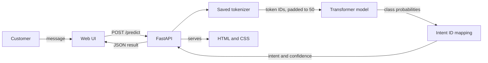
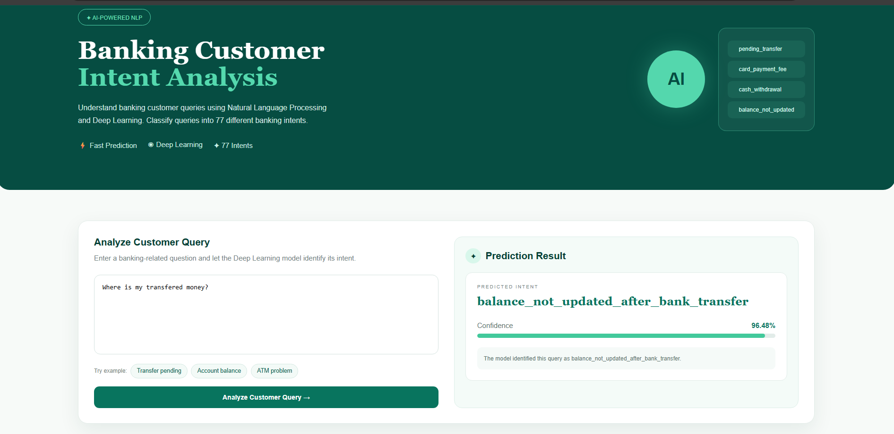

# Banking Customer Intent Analysis

Classify English banking-support messages into one of 77 customer intents using a Transformer model and a FastAPI web app.

## Problem statement

Banking support teams receive many short messages that need to be routed to the right issue category. This project predicts a customer's intent from their message and returns the predicted label and model confidence.

## Features

- Predicts among 77 intents from the BANKING77 dataset.
- Interactive web interface with example banking queries.
- JSON prediction endpoint (`POST /predict`) and health endpoint (`GET /health`).
- Returns the predicted intent ID, intent label, and softmax confidence.

## Tech stack

- **Python** — application and inference code.
- **TensorFlow / Keras** — Transformer model training and prediction.
- **FastAPI** — prediction and health endpoints.
- **Jinja2, HTML, CSS** — server-rendered web interface.

## Architecture



The tokenizer and model are applied to the input in sequence; the model's highest-scoring class is mapped to its intent label.

## Installation and setup

Use Python 3.10–3.12. From the project directory, create and activate a virtual environment and install the app dependencies:

```powershell
python -m venv .venv
.\.venv\Scripts\Activate.ps1
python -m pip install -r requirements.txt
```

## Run the project

Start the development server from the project directory:

```powershell
python -m uvicorn main:app --reload
```

Open [http://127.0.0.1:8000](http://127.0.0.1:8000) to use the web app. The app loads model assets from `models/`, so run it from the project directory. `GET /health` checks app status; `POST /predict` accepts a JSON body such as `{"text":"Why is my transfer pending?"}`.

## Screenshots



## Evaluation / testing results

The notebook evaluates four models on the BANKING77 test split (3,080 examples). The LSTM is the reference baseline among the tested neural models; this is not a majority-class or traditional ML baseline. Reported precision, recall, and F1 are weighted averages.

| Model | Test accuracy | Weighted precision | Weighted recall | Weighted F1 |
|---|---:|---:|---:|---:|
| LSTM (reference baseline) | 72.92% | 73.34% | 72.92% | 71.52% |
| GRU | 83.34% | 84.16% | 83.34% | 83.35% |
| BiLSTM | 83.41% | 84.60% | 83.41% | 83.44% |
| **Transformer (selected)** | **84.22%** | **85.25%** | **84.22%** | **84.19%** |

The selected Transformer improves test accuracy by 11.30 percentage points over the LSTM reference and has the highest weighted F1 of the models compared.

## Future improvements

- Publish a hosted demo or short walkthrough video.
- Calibrate confidence and add an abstain option for uncertain or out-of-domain inputs.
- Evaluate on real-world support messages and compare against a simple non-neural baseline.
- Add automated API and inference tests.
